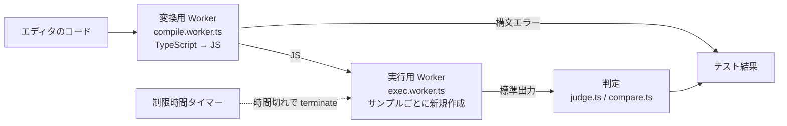

# tsdrill

ブラウザ上で TypeScript のコーディング問題を解く演習アプリ。AtCoder のような「標準入力を読んで答えを出力する」形式の問題を、エディタで書いてその場で実行・判定できる。

- 問題・模範解答・解説はあらかじめ用意した JSON（全 100 問、難易度 5 段階）
- 書いたコードは**ブラウザの中で実行**する。サーバーには送らない
- ログイン・データベースなし。静的サイトとして Cloudflare Workers で公開している

## 主な機能

| 機能 | 内容 |
|---|---|
| 3 ペイン画面 | 左に問題、中央にエディタとテスト結果、右に模範解答。境目のドラッグで幅を変えられる（ダブルクリックで元に戻る） |
| ランダム出題 | 「次の問題へ」で今の問題以外からランダムに出題。難易度（入門・初級・中級・上級・最上級）で絞り込める |
| エディタ | Monaco Editor。シンタックスハイライト、括弧の自動補完と対応括弧の強調、型エラーの波線表示 |
| 実行・判定 | 「実行」でサンプルケースごとに実行し、正解・不正解・実行時エラー・時間切れ・構文エラーを表示。実行時間も出す |
| 模範解答 | 初期は非表示。「模範解答を見る」ですぐ表示され、要点つきの解説が読める |
| テーマ | ダーク／ライトを切り替えられる |

テーマとパネル幅はブラウザ（localStorage）に保存される。それ以外のデータ（書いたコード、実行結果、履歴）は保存しない。

## 使える入出力

問題は標準入力から読み、標準出力に答えを書く。エディタの雛形は次のとおり。

```ts
import * as fs from "fs";

const input: string[] = fs.readFileSync(0, "utf8").trim().split("\n");

// ここに解答を書く
```

ブラウザ内の実行環境で使える Node.js の機能は次だけ。

- `fs.readFileSync(0)`（または `"/dev/stdin"`）… 標準入力の文字列を返す
- `console.log` / `process.stdout.write` … 標準出力（判定に使う）
- `console.error` / `process.stderr.write` … 標準エラー出力（判定には使わない）
- `process.exit()`

`readline` やファイルの読み書き、非同期処理の中での出力には対応していない。出力は各行の末尾の空白と最後の空行を無視して比べる。

## 構成

### ディレクトリ

```
ts-drill/
├── problems/                        問題データ（1 問 1 ファイル、全 100 問）
│   ├── adjacent-diff-max.json
│   ├── count-evens.json
│   └── …                             置くだけでアプリに出る。一覧への登録は不要
├── scripts/
│   └── verify-problems.ts           問題の検証。模範解答を実行し、サンプルの出力と照合する
├── docs/
│   ├── problem-authoring.md         問題の作り方（AI に頼むときの手順書）
│   └── deploy.md                    Cloudflare へのデプロイ手順と npm のバージョンの注意
├── src/
│   ├── app/                         URL のルーティングだけ（Next.js の App Router）
│   │   ├── layout.tsx               ルートレイアウト。描画前に保存済みのテーマを反映する
│   │   ├── page.tsx                 トップページ（/）。ビルド時に全問題を読み込んで渡す
│   │   ├── globals.css              色のトークン（ダーク／ライト）と Tailwind の設定
│   │   └── favicon.ico              /favicon.ico
│   ├── components/                  UI の部品（表示と操作だけ。処理は lib/ を呼ぶ）
│   │   ├── client-app.tsx           画面本体をブラウザだけで描画する（ssr: false）
│   │   ├── tsdrill-app.tsx          画面全体。出題・実行・模範解答の表示などの状態を持つ
│   │   ├── header.tsx               ロゴ、難易度の選択、次の問題へ、テーマ切り替え
│   │   ├── resizable-columns.tsx    3 つのパネルの横並びと、境目のドラッグ
│   │   ├── problem-panel.tsx        左: 問題文・制約・入出力形式・サンプル
│   │   ├── editor-panel.tsx         中央: エディタ、ステータスバー、テスト結果
│   │   ├── solution-panel.tsx       右: 模範解答のコードと解説（表示／非表示）
│   │   ├── code-editor.tsx          Monaco のエディタ（編集用）と読み取り専用ビュー
│   │   ├── ui.tsx                   パネル、ボタン、ピル、コード枠などの共通部品
│   │   └── icons.tsx                インライン SVG のアイコン
│   └── lib/                         機能（UI を持たない処理・型・設定）
│       ├── problem.ts               問題の型（Problem）と難易度の定義
│       ├── load-problems.ts         problems/*.json をビルド時にすべて読み込む（サーバー側専用）
│       ├── problem-picker.ts        難易度での絞り込み、ランダム出題、難易度ごとの問題数
│       ├── pane-sizes.ts            パネル幅の比率の計算と保存
│       ├── theme.ts                 テーマの型と保存キー
│       ├── use-theme.ts             テーマの切り替えと保存（React フック）
│       ├── fonts.ts                 Zen Kaku Gothic New と JetBrains Mono の読み込み
│       ├── monaco-setup.ts          Monaco の読み込み元・配色テーマ・ハイライト規則・型情報
│       └── runner/                  コード実行エンジン
│           ├── judge.ts             判定の入口。変換 → サンプルごとに実行 → 比較 → 結果
│           ├── compile.worker.ts    変換用 Worker（常駐）
│           ├── transpile.ts         TypeScript → JS の変換と構文エラーの取り出し
│           ├── exec.worker.ts       実行用 Worker（サンプルごとに作り直す）
│           ├── execute.ts           JS の実行。fs・console・process を模擬して出力を集める
│           └── compare.ts           出力の比較（行末の空白と末尾の空行を無視）
├── AGENTS.md                        AI 向けの作業ルール（CLAUDE.md から読み込まれる）
├── CLAUDE.md
├── README.md
├── next.config.ts                   静的書き出し（output: "export"）の設定
├── wrangler.jsonc                   Cloudflare Workers の設定（out/ を静的に配信）
├── eslint.config.mjs
├── tsconfig.json
├── package.json                     npm 10.9.2 を指定（packageManager / devEngines）
└── package-lock.json
```

ビルドすると `out/` に静的ファイル一式ができる（Git には含めない）。

### 画面のコンポーネント

```
page.tsx                             ビルド時: problems/*.json を読んで渡す
└── ClientApp (client-app.tsx)       ブラウザでだけ描画する
    └── TsdrillApp (tsdrill-app.tsx) 状態: 現在の問題・難易度・コード・実行結果・模範解答の表示・テーマ
        ├── Header                   難易度の選択、次の問題へ、テーマ切り替え
        └── ResizableColumns         横並びと境目（幅 1024px 未満は縦積み）
            ├── ProblemPanel         問題
            ├── EditorPanel          実行ボタン
            │   ├── CodeEditor       Monaco（solution.ts）
            │   ├── ステータスバー     カーソル位置
            │   └── テスト結果         サンプルごとの判定・出力・実行時間
            └── SolutionPanel        模範解答
                ├── CodeViewer       Monaco（読み取り専用）
                └── 解説
```

### コードを実行する仕組み



「実行」を押したときの流れ:

```
EditorPanel の「実行」
└── judge(コード, サンプル, 制限時間)                      judge.ts
    ├── 1. 変換: compile(コード)                           変換用 Worker（常駐）
    │   ├── transpileModule で TypeScript → JS（CommonJS）
    │   └── 構文エラーがあれば → 「構文エラー」として行・列・メッセージを返して終了
    └── 2. サンプルごとに順番に実行                         runOnce()
        ├── 新しい実行用 Worker を作る                     exec.worker.ts
        ├── Worker から "ready" が届いたら、制限時間のタイマーを開始
        ├── JS と入力文字列を Worker に送る
        │   └── executeJs(JS, 入力)                         execute.ts
        │       ├── fs.readFileSync(0) → 入力文字列を返す
        │       ├── console.log / process.stdout.write → 出力を溜める
        │       └── 実行時間を計り、出力（またはエラー）を返す
        ├── 結果を受け取るか時間切れになったら、Worker を terminate
        └── 判定して画面のその行をすぐ更新する
            ├── 時間切れ（または実行時間が制限超え） → 時間切れ
            ├── 例外が出た                         → エラー（メッセージを表示）
            └── 出力を比べる（compare.ts）          → 正解 / 不正解
```

- **変換**: `typescript` の `transpileModule` で JS（CommonJS）に変換する。型検査はせず、構文エラーだけを返す（型エラーはエディタの波線で見せる）。変換用 Worker は 1 つを使い回し、画面を開いた時点で先読みしておく。
- **実行**: サンプル 1 件ごとに新しい Worker を作って実行する。`require("fs")` と `process` は模擬したものを渡す（`execute.ts`）。制限時間を過ぎたら Worker ごと終了させるので、無限ループでも画面は固まらない。
- **共通化**: `execute.ts`・`transpile.ts`・`compare.ts` は DOM にも Node にも依存しない。同じコードを、ブラウザの Worker と問題の検証スクリプトの両方で使っている。

### 問題データ

`problems/<id>.json` に 1 問ずつ置く。形は `src/lib/problem.ts` の `Problem` 型のとおり（タイトル、難易度、問題文、制約、入出力形式、サンプル、模範解答、解説など）。

ビルド時に `src/lib/load-problems.ts` がフォルダ内のファイルをすべて読み、ページに埋め込む。一覧への登録は不要。

サンプルの出力は人や AI が手で書かず、**模範解答を実行して得た値**を入れる（`npm run verify -- --write <id>`）。問題文・サンプル・模範解答が食い違うのを防ぐため。

| 難易度 | 問題数 | 目安（AtCoder ABC） |
|---|---|---|
| 入門 | 25 | A 問題 |
| 初級 | 25 | B 問題 |
| 中級 | 20 | C 問題 |
| 上級 | 15 | D 問題 |
| 最上級 | 15 | E〜F 問題 |

## 技術スタック

- Next.js 16（App Router、静的書き出し `output: "export"`）／ React 19 ／ TypeScript
- Tailwind CSS 4
- Monaco Editor（`@monaco-editor/react`。本体は jsDelivr の CDN から読み込む）
- `typescript`（ブラウザ内での TS → JS 変換）
- Cloudflare Workers（静的アセットの配信）／ wrangler

## 開発

Node.js 24 と npm 10.9.2 を前提にしている。

```bash
npm ci          # 依存のインストール
npm run dev     # 開発サーバー（http://localhost:3000）
```

| コマンド | 内容 |
|---|---|
| `npm run dev` | 開発サーバーを起動する |
| `npm run build` | 静的ファイルを `out/` に書き出す |
| `npm run lint` | ESLint |
| `npm run verify` | 全問題の模範解答を実行し、サンプルと一致するか検証する |
| `npm run verify -- --write <id>` | 模範解答の出力で、指定した問題のサンプルの出力を書き込む |
| `npm run preview` | ビルドして、Cloudflare と同じ配信方法で `http://localhost:8787` に立ち上げる |
| `npm run deploy` | 手元から Cloudflare にデプロイする（通常は GitHub 連携で自動） |

サーバーを止めるときは、起動したターミナルで `Ctrl + C`。

### npm のバージョンについて

Cloudflare のビルド環境は npm 10.9.2 で、npm 11 が書いた `package-lock.json` を受け付けないことがある。そのため `package.json` の `packageManager` と `devEngines` で npm 10.9.2 を指定している。パッケージを追加・更新するときは次のようにする。

```bash
npx npm@10.9.2 install <パッケージ>
```

## 問題を追加する

[docs/problem-authoring.md](docs/problem-authoring.md) の手順に従う。要点は次のとおり。

1. `problems/<id>.json` を書く（サンプルの `output` は空文字のまま）
2. `npm run verify -- --write <id>` で、模範解答の出力を書き込む
3. 書き込まれた出力が問題文どおりか確かめ、`npm run verify` が全問 OK になることを確認する

AI（Claude Code など）に頼む場合も、[AGENTS.md](AGENTS.md) からこの手順書を参照するようにしてある。

## デプロイ

GitHub の `main` に push すると、Cloudflare Workers Builds が `npm run build` → `npx wrangler deploy` を自動で実行し、`out/` を公開する。初回の設定などは [docs/deploy.md](docs/deploy.md) を参照。

## 制限

- 判定に使うのはサンプルケースだけ。隠しテストケースはまだない（JSON に `hiddenTests` の欄だけある）
- 上級・最上級の模範解答は、サンプルを通ることまでしか自動で確かめていない
- 答えが 1 つに決まる問題だけを扱える（複数の正解を許す判定はない）
- メモリ使用量の制限はない（ブラウザ内では制限できないため）
